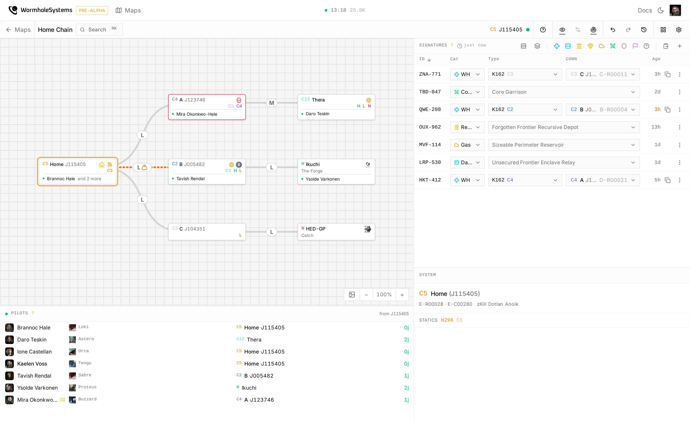

<div align="center">

<picture>
  <source media="(prefers-color-scheme: dark)" srcset=".github/assets/logo-dark.svg">
  
</picture>

# WormholeSystems

**A real-time wormhole mapper for EVE Online.**

Shared chain maps, signatures, mass and lifetime per hole, routes through the chain and
live pilot locations, for corporations and alliances living in J-space.

[](https://github.com/wormholesystems/wormholesystems/actions/workflows/ci.yml)
[](https://github.com/wormholesystems/wormholesystems/pkgs/container/wormholesystems-api)
[](https://github.com/wormholesystems/wormholesystems/releases/latest)
[](#beta)
[](LICENSE)
[](https://discord.gg/rpfWCzVJS7)

[Open the app](https://wormhole.systems) ·
[Documentation](https://wormhole.systems/documentation) ·
[Self-hosting](#run-your-own) ·
[API](https://wormhole.systems/api/docs)

<br>

<picture>
  <source media="(prefers-color-scheme: dark)" srcset=".github/assets/app-dark.webp">
  
</picture>

</div>

## What it does

When a corpmate pastes their probe scanner, resolves a hole or marks a connection
end-of-life, it is on your screen before they have finished typing.

- **Map the chain**: add systems and connections by hand, or let jump tracking log them as
  you fly.
- **Track signatures**: paste the probe scanner and the map syncs, then link each wormhole
  to the connection it turned out to be.
- **Watch each hole**: mass and lifetime per connection, so a fleet knows what a hole will
  still take.
- **Plan routes**: the shortest or safest way through the chain, with in-game waypoints
  set for you.
- **See your group**: where every tracked character is, live from ESI.
- **Control access**: per character, corporation or alliance, down to who may edit.
- **Get told**: Discord alerts for kills, proximity, and capitals in jump range.
- **Script it**: everything the map screen does is in the [API](./docs/api.md), with
  personal access tokens.

## Beta

It is in daily use and updates migrate your data in place, but it is still moving. The
interface and the API change between updates, so pin what you script against, and expect
the odd rough edge. `wsctl update` dumps the database before every update; keep those.

## Run your own

You need Docker, a domain pointed at the machine, and an EVE application from the
[developer portal](https://developers.eveonline.com/) with the `esi-location.*` scopes.

```sh
curl --proto '=https' --tlsv1.2 -sSf https://install.wormhole.systems | sh
wsctl setup
```

`wsctl setup` checks the machine, asks for what it needs, writes `.env` and brings the
stack up. It runs everything itself (Postgres and Caddy included), or uses a Postgres and
a reverse proxy you already have; `wsctl integrate` then prints what that proxy needs.

| Command | What it does |
|---|---|
| `wsctl update` | new code and newer static data, dumping the database first |
| `wsctl backup` / `wsctl restore` | the same dump, by hand |
| `wsctl status` | what is running and whether it answers |

[docs/deployment.md](./docs/deployment.md) covers the rest.

## Developing

Rust ([axum](https://github.com/tokio-rs/axum), [sqlx](https://github.com/launchbadge/sqlx),
Postgres) for the API, [SvelteKit](https://svelte.dev) for the frontend. The whole stack,
the way it runs in production:

```sh
cp .env.example .env       # then fill in the EVE application and contact details
docker compose up -d --build
```

That serves http://localhost. For quick iteration, run Postgres in Docker and the API and
frontend on the host instead:

```sh
docker compose up -d db
cargo install sqlx-cli --no-default-features --features postgres,rustls,sqlx-toml
cargo sqlx migrate run
cargo run -- seed          # the SDE: a few hundred MB the first time
cargo run                  # API on :3000
cd frontend && npm install && npm run dev
```

`cargo test` builds its own database per test and needs `DATABASE_URL` set. After changing
a query, `cargo sqlx prepare --workspace -- --all-targets` refreshes the offline cache that
CI compiles against; a pre-push hook checks it is current.

<details>
<summary>Where things live</summary>

- `src/`: the API. `src/maps/` holds the rules, `src/api/` only decodes and dispatches.
- `frontend/`: SvelteKit, the map canvas, the panels and their state.
- `frontend/src/docs/`: the user documentation served at `/documentation`.
- `migrations/`: the schema, each file creating its tables in their final shape.
- `wsctl/`: the operator CLI that installs, updates and inspects a deployment.
- `docs/`: how it works underneath: data model, ESI endpoints, background processes.

</details>

## Contributing

Issues and pull requests are welcome. The documentation is the easiest place to start: it
is Markdown in `frontend/src/docs/`, and a new page needs nothing but a file. See
[frontend/src/docs/README.md](./frontend/src/docs/README.md). Security issues go through
[SECURITY.md](./.github/SECURITY.md).

The original Laravel app lives on at
[wormholesystems-legacy](https://github.com/wormholesystems/wormholesystems-legacy) and
[legacy.wormhole.systems](https://legacy.wormhole.systems).

## License

MIT. See [LICENSE](./LICENSE). EVE Online and all related materials are the property of
CCP hf.
